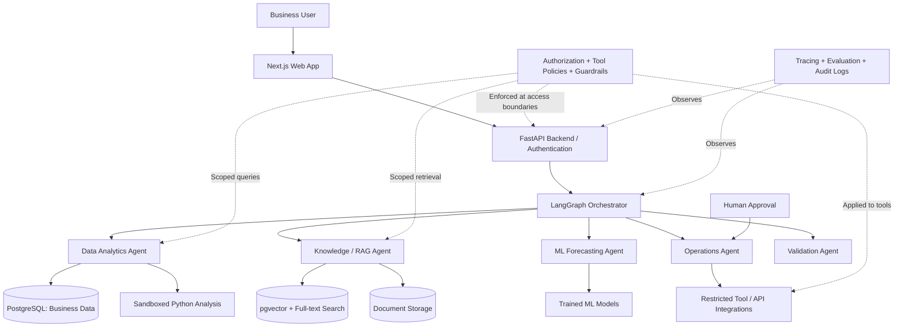

<div align="center">

# CortexOps AI

### Secure Enterprise AI Intelligence & Automation Platform

**Turn disconnected business data and documents into verifiable insights, predictive intelligence, and human-approved actions.**


*An advanced, portfolio-oriented AI engineering project. Features described below are the intended scope unless marked otherwise.*

</div>

---

## Overview

Organizations often keep business information in disconnected systems: transactional databases, spreadsheets, invoices, company policies, reports, and operational tools. Answering a business question can require analysts to query multiple sources, review documents, run models, coordinate employees, and manually act on the results.

**CortexOps AI** aims to unify this workflow in one secure application. A user asks a business question in natural language; a coordinated set of AI agents retrieves authorized data, performs verifiable analysis, consults relevant documents, runs predictive models, and prepares operational actions for review and approval.

> **Example request:** “Why did revenue decline last quarter? Which products and branches contributed most? Forecast next month's performance, check our discount policies, and prepare a recovery plan for approval.”

The envisioned result is more than a chatbot response: **reproducible calculations, interactive charts, cited evidence, forecast outputs, recommended next steps, and traceable approval workflows**.

## The Problem

Traditional analytics and business operations are frequently fragmented:

- **Data silos:** Information lives across SQL databases, CSV/Excel files, and document repositories.
- **Slow investigation:** Analysts manually combine data, dashboards, policies, and reports.
- **Limited accessibility:** Non-technical teams cannot easily interrogate databases or models.
- **Disconnected decisions:** Insights rarely flow directly into operational tools and workflows.
- **Trust and security gaps:** AI-generated answers can be unsupported, numerically wrong, or based on data users should not access.

**Our goal:** Reduce the gap between **business data → evidence-backed decisions → controlled actions** without sacrificing human oversight.

## What CortexOps AI Will Do

| Capability | Description | Origin |
| --- | --- | --- |
| **Conversational Business Analytics** | Translate questions into validated, read-only SQL and Python-based analysis; generate charts and reports. | InsightAI |
| **Enterprise Document Intelligence** | Ingest documents; retrieve relevant evidence with hybrid search, reranking, and source citations. | DocuMind |
| **Predictive Machine Learning** | Forecast demand/revenue, flag anomalies, and surface customer or delivery risks using trained ML models. | InsightAI + ML |
| **Multi-Agent Orchestration** | Delegate steps to specialized agents, preserve workflow state, recover from failures, and compose final findings. | OpsPilot |
| **Human-Approved Operations** | Draft follow-ups and operational tasks; execute privileged actions only after explicit approval. | OpsPilot |
| **AI Security & Governance** | Enforce access controls, protect sensitive information, constrain tool usage, and audit decisions and actions. | AIGuard |
| **Evaluation & Observability** | Measure SQL correctness, retrieval quality, forecast performance, agent success, latency, and cost. | Platform-wide |

### Example end-to-end workflow

1. **Ask:** A manager requests an investigation into falling sales.
2. **Plan:** A coordinating agent breaks the request into data, document, modeling, and action tasks.
3. **Analyze:** A data agent uses authorized read-only queries and reproducible Python calculations.
4. **Retrieve:** A knowledge agent finds relevant policy passages and cites their sources.
5. **Predict:** An ML agent invokes an evaluated forecasting model and reports uncertainty/limitations.
6. **Recommend:** An operations agent proposes evidence-backed actions.
7. **Approve:** A human reviews changes or external communications before execution.
8. **Audit:** The system records inputs, retrieved evidence, tool calls, approvals, results, and failures.

## System Architecture (Proposed)



**Architecture principle:** Agents may propose actions, but authorization is enforced by application code and scoped tools—not by trusting an LLM to follow a prompt.

## Planned AI Agents

| Agent | Primary responsibility | Representative outputs |
| --- | --- | --- |
| **Planner / Coordinator** | Decompose requests, choose tools/agents, track state | Execution plan, subtasks |
| **Analytics Agent** | Read-only SQL, calculations, EDA, visualizations | Queries, tables, charts |
| **Knowledge Agent** | Search documents and synthesize cited evidence | Relevant passages, citations |
| **ML Agent** | Load and execute evaluated prediction models | Forecasts, risk scores, uncertainty |
| **Operations Agent** | Prepare operational tasks and draft messages | Action proposals, approval requests |
| **Validation Agent** | Check claims against tool outputs and source evidence | Validation results, detected inconsistencies |

## Core Modules

### 1. AI Analytics & Text-to-SQL

- Natural-language questions over an authorized relational schema.
- SQL validation, table/column allowlists, query limits, and read-only database credentials.
- Reproducible Python computations for complex analysis.
- Interactive dashboards, KPI drill-downs, and exports.
- Clear separation of **observed data**, **model predictions**, and **LLM-generated explanations**.

### 2. Advanced RAG & Document Intelligence

- PDF, DOCX, and spreadsheet ingestion (subject to supported parsers).
- Metadata-rich chunking and source/page references.
- Hybrid keyword + vector retrieval and optional reranking.
- Document-level authorization and safe treatment of retrieved content as untrusted data.
- Evidence-linked answers with explicit abstention when support is insufficient.

### 3. Predictive Intelligence

Planned ML use cases include:

- Revenue or demand forecasting.
- Customer segmentation (for example, RFM + clustering).
- Delivery-delay or customer-satisfaction risk classification.
- Anomaly detection for unexpected sales or order patterns.

Models will be compared with simple baselines and evaluated using appropriate chronological splits or held-out test sets to reduce leakage.

### 4. Agentic Workflows & Approvals

- Stateful, resumable multi-step workflows.
- Sandboxed analysis execution and restricted API tools.
- Human-in-the-loop review for messages, data changes, and external actions.
- Idempotency checks, retries, failures, and execution audit trails.

### 5. Security & Governance

- Organization/tenant isolation and role-based access control.
- Least-privilege data access and parameterized/validated tool boundaries.
- Sensitive-data handling and secrets management.
- Prompt-injection defenses and adversarial evaluation.
- Auditable user, model, and tool activity.

> **Security note:** Prompt filters alone are not a security boundary. Sensitive operations must be protected by deterministic authorization and scoped credentials.

## Proposed Technology Stack

| Layer | Tools / technologies |
| --- | --- |
| **Frontend** | Next.js, TypeScript, Tailwind CSS, shadcn/ui, Plotly or Recharts |
| **Backend** | Python, FastAPI, Pydantic |
| **Agent framework** | LangGraph |
| **LLMs** | Configurable model API or locally hosted model |
| **Data analytics** | Pandas, NumPy, Polars (optional), SQLAlchemy |
| **Machine learning** | Scikit-learn, XGBoost or LightGBM, Optuna, SHAP |
| **Database / vector search** | PostgreSQL + pgvector + PostgreSQL full-text search |
| **Background jobs** | Redis + Celery (as needed) |
| **Document storage** | Local development storage; S3-compatible object storage for deployment |
| **Monitoring / evaluation** | OpenTelemetry, Langfuse or equivalent, custom test suites |
| **Deployment** | Docker, GitHub Actions, cloud hosting |

*The stack may evolve during implementation; this is a design target, not a claim that all dependencies are installed.*

## Datasets

The initial focus is a **retail/e-commerce** business domain, so the analytics, document, ML, and action agents can participate in the *same* investigation.

| Dataset | Intended use | Source / conditions |
| --- | --- | --- |
| **Olist Brazilian E-Commerce** | Primary relational business dataset: orders, payments, products, customers, sellers, reviews, delivery | [Kaggle](https://www.kaggle.com/datasets/olistbr/brazilian-ecommerce) — free for qualifying uses under its **CC BY-NC-SA 4.0** license |
| **M5 Forecasting** | Separate benchmark for advanced multi-series demand forecasting | [Kaggle competition](https://www.kaggle.com/competitions/m5-forecasting-accuracy/data) — access and reuse subject to competition terms |
| **Mexico Toy Sales** | Optional separate organization/demo for store sales, product costs, and inventory analysis | [Maven Analytics](https://mavenanalytics.io/data-playground/mexico-toy-sales) — review source terms before redistribution |
| **Fictional enterprise documents** | Example internal policies, refund procedures, operational playbooks for testing RAG | Author-created, clearly marked **synthetic/demo content** |

**Important data boundaries**

- The datasets describe **different businesses**; they must not be joined as though they share real identifiers.
- The Olist dataset does **not** include a complete inventory or true cost-of-goods ledger; avoid presenting invented profits or stock levels as factual.
- Use temporal splits for forecasting and label definitions that avoid target leakage.
- Do not commit raw datasets with restrictive terms, sensitive data, or large generated model artifacts to GitHub. Keep download/setup instructions and attribution instead.

## Evaluation Plan

| Area | Suggested method | Metrics / evidence |
| --- | --- | --- |
| **Text-to-SQL** | Curated questions with verified expected query results | Result-set correctness, unsafe-query rejection rate |
| **RAG** | Questions with known supporting documents/passages | Retrieval recall@k, citation accuracy, grounded answer rate |
| **Forecasting** | Time-based backtesting vs naive baselines | MAE, RMSE, WAPE/sMAPE as appropriate |
| **Classification** | Held-out test set with leakage checks | PR-AUC, ROC-AUC, F1, calibration |
| **Agent workflows** | End-to-end task benchmark with injected failures | Task success rate, recovery success, unnecessary tool calls |
| **Security** | Unauthorized-access and prompt-injection test cases | Attack success rate, policy violations, false positives |
| **Operations** | Load, cost, and reliability testing | p50/p95 latency, token cost, error rate, throughput |

**Evaluation counts and performance numbers will be reported only after actual experiments.** This README does not claim benchmark results yet.

## Intended Repository Structure

The following is a **proposed structure**, not a list of files already implemented:

```text
cortexops-ai/
├── README.md
├── LICENSE                       # To be selected before release
├── .env.example                  # Document required variables; no secrets
├── docker-compose.yml            # Local services (planned)
├── apps/
│   └── web/                      # Next.js frontend
├── services/
│   └── api/                      # FastAPI backend
│       ├── app/
│       │   ├── api/
│       │   ├── agents/
│       │   ├── analytics/
│       │   ├── rag/
│       │   ├── ml/
│       │   ├── integrations/
│       │   ├── security/
│       │   └── evaluations/
│       └── tests/
├── pipelines/
│   ├── ingestion/                # Data/document ingestion
│   └── training/                 # ML training and evaluation
├── data/
│   └── README.md                 # Download instructions, licenses
├── docs/
│   ├── architecture.md
│   ├── security.md
│   └── evaluation.md
└── .github/
    └── workflows/               # CI/CD
```

## Development Roadmap

- [ ] **Phase 1 — Foundation:** Repository setup, frontend shell, API, authentication, data modeling, PostgreSQL ingestion.
- [ ] **Phase 2 — Analytics:** Read-only Text-to-SQL, charts, deterministic numerical validation, initial evaluation set.
- [ ] **Phase 3 — Knowledge:** Document ingestion, embeddings, hybrid search, reranking, citations, authorization.
- [ ] **Phase 4 — ML:** Time-aware forecasting, classification/segmentation, model registry, inference endpoints.
- [ ] **Phase 5 — Agents:** Planner, specialist agents, durable state, workflow recovery, integration tools.
- [ ] **Phase 6 — Governance:** Access policies, human approvals, adversarial tests, audit trails.
- [ ] **Phase 7 — Production Readiness:** Automated evaluations, tracing, CI/CD, containerization, deployment, demo.

## Running the Project

**The application is not yet published as a runnable build.** Installation instructions will be added once the frontend, API, and local infrastructure are implemented. Until then, do not assume the proposed directory structure or commands exist.

When available, this section will include:

1. Prerequisites (Python, Node.js, Docker, PostgreSQL).
2. Environment setup using an `.env.example` file.
3. Database migrations and optional sample-data import.
4. API and frontend startup commands.
5. Test and evaluation commands.
6. Demo account setup and safe local tooling instructions.

## Planned Demo

**Scenario: Revenue Investigation & Recovery**

A user asks CortexOps AI to explain a revenue decline, identify affected product categories, predict near-term demand, consult internal policies, and prepare a follow-up plan. The demonstration will show:

1. Agent planning and transparent tool execution.
2. Validated SQL results and interactive analysis.
3. RAG citations to supporting documents.
4. An ML forecast with limitations or uncertainty.
5. Suggested operational tasks that pause for approval.
6. An audit trail and at least one handled failure or adversarial case.

## Responsible AI Principles

- **Evidence over confidence:** Cite sources and verify calculations; say when evidence is unavailable.
- **Human control:** Require approval for consequential external actions.
- **Least privilege:** Limit each agent/tool to only the data and operations it needs.
- **Transparency:** Separate factual data, predictions, and generated recommendations.
- **Reproducibility:** Version evaluation datasets, prompts, models, and workflows where practical.
- **Privacy:** Use appropriately licensed, non-sensitive datasets and synthetic documents for public demonstrations.

## Project Status

**In development / design stage.** This README describes the intended architecture and goals. No deployed product, completed benchmark, or implemented integration is claimed here. Progress will be reflected by checked roadmap items, source code, tests, and release notes as development proceeds.

## Contributing

Contributions and constructive feedback are welcome once the repository is opened for collaboration. Future contribution guidelines will cover reproducible setup, tests, security reporting, and coding conventions.

## License

**Application source-code license: not selected yet.** A license file should be added before declaring the application open source. Third-party datasets, models, libraries, and document assets retain their own licenses and terms; the application license does not supersede them.

---

<div align="center">

**CortexOps AI** — From fragmented data to trustworthy decisions and approved action.

*Built to demonstrate applied AI engineering, machine learning, advanced RAG, secure agent orchestration, and full-stack development.*

</div>
